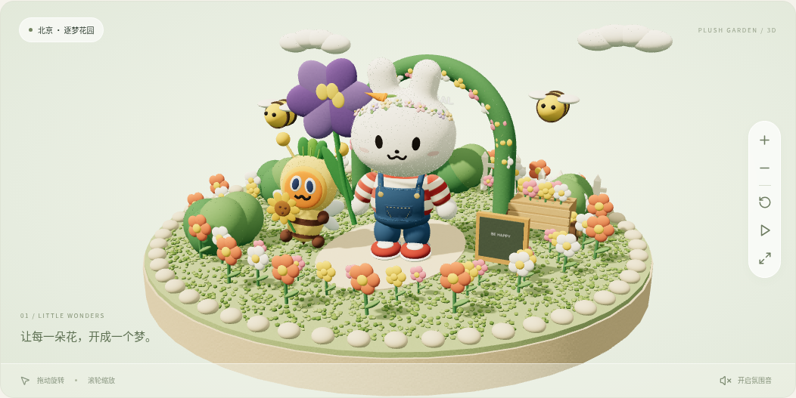
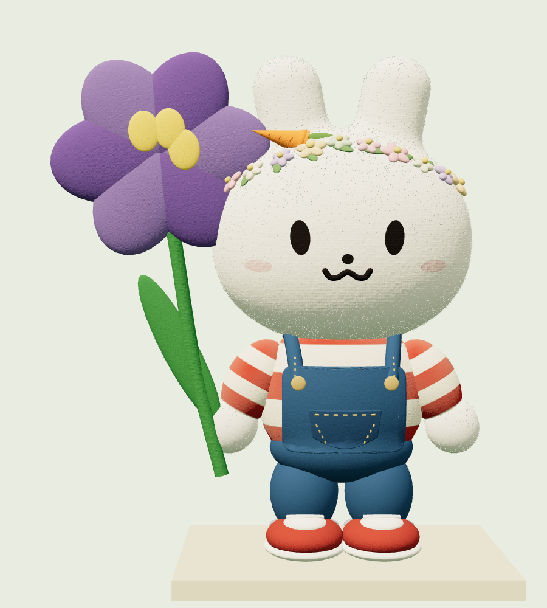
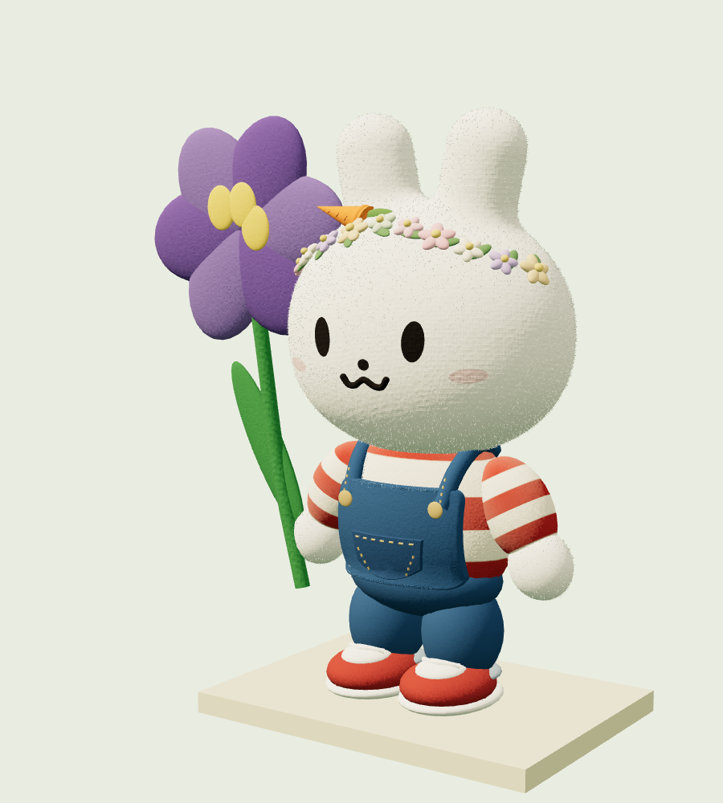
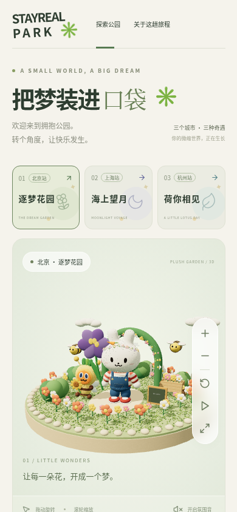

# 毛绒花园 · 实际效果

这里展示当前程序在浏览器中的实际渲染效果，区别于 [风格概念图](../concepts/README.md)。

兔子参考实体公仔重新调整肩颈衔接和身体比例：下脸颊更饱满，头部直接接在条纹上衣上，躯干不再压缩，背带裤沿身体曲面贴合，裤腰收小并露出完整双腿。保留花环、牛仔缝线和蜜蜂装胡萝卜。

第一个场景仍使用短绒纤维、布料纹理、毛毡花草和柔软绒簇地面。下面的模型近景与公园使用同一份 Three.js 模型代码。

## 花园实机截图

## 同一兔子模型的近景

## 侧面衔接

## 手机页面

运行方式见 [项目说明](../../README.md)。鼠标拖动旋转、滚轮缩放，右侧工具可暂停动画和重置视角。
